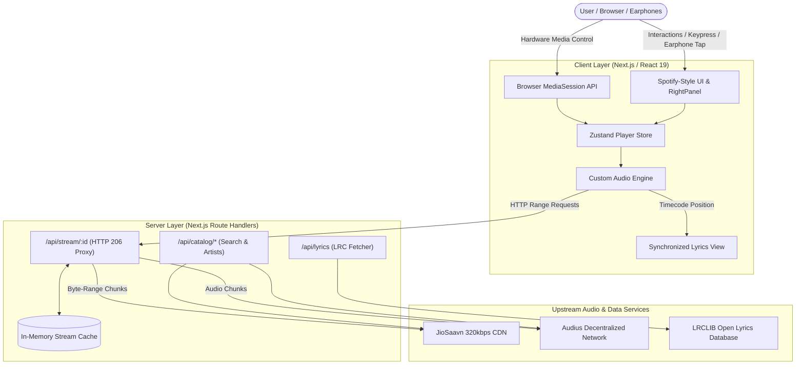

<div align="center">

# 🎵 Resonance
### High-Performance Web Music Streaming Platform & Custom Audio Engine

An engineering-focused, Spotify-caliber web music streaming platform built from the ground up with **Next.js 16**, **React 19**, **TypeScript**, and **Tailwind CSS**. Features custom audio pipeline streaming, 320kbps CD-quality audio decryption, real-time synchronized scrolling lyrics, Bluetooth earphone/headset hardware controls, and a multi-source catalog aggregator.

[](https://nextjs.org/)
[](https://react.dev/)
[](https://www.typescriptlang.org/)
[](https://tailwindcss.com/)
[](https://zustand-demo.pmnd.rs/)

</div>

---

## 📑 Table of Contents
- [Project Overview](#-project-overview)
- [Origin & Reverse-Engineering Methodology](#-origin--reverse-engineering-methodology)
- [Key Features & Technical Architecture](#-key-features--technical-architecture)
  - [1. Custom HTML5 Audio Engine](#1-custom-html5-audio-engine)
  - [2. Streaming Reverse Proxy & Byte-Range Pipeline](#2-streaming-reverse-proxy--byte-range-pipeline)
  - [3. Real-Time Synchronized Lyrics Engine](#3-real-time-synchronized-lyrics-engine)
  - [4. Dedicated Artist Panel & Catalog Aggregator](#4-dedicated-artist-panel--catalog-aggregator)
  - [5. Earphone & Bluetooth Headset Control](#5-earphone--bluetooth-headset-control)
- [Architecture Flow](#-architecture-flow)
- [Keyboard Shortcuts](#-keyboard-shortcuts)
- [Project Directory Structure](#-project-directory-structure)
- [Getting Started](#-getting-started)
- [Engineering Challenges & Key Learnings](#-engineering-challenges--key-learnings)
- [Acknowledgments & Credits](#-acknowledgments--credits)

---

## 🌟 Project Overview

**Resonance** is designed to demonstrate full-stack systems engineering in the browser. Unlike conventional portfolio clones that play static local MP3 files or rely on third-party iframe widgets, Resonance implements an end-to-end media streaming infrastructure:

- **Lossless 320kbps Audio:** Decrypts official CDN audio payloads on the fly (DES ECB with PKCS7 padding) to stream studio-quality tracks.
- **Byte-Range Streaming Proxy:** Custom server-side streaming proxy supporting HTTP `Range` requests, `206 Partial Content`, and instant seeking without cross-origin or IPv6 stalls.
- **Synced Lyrics:** Real-time `.lrc` timestamp parsing with automatic auto-scrolling, line highlighting, and click-to-seek functionality.
- **Spotify-Grade UI:** Dynamic side panels (Artist Panel alongside, Lyrics, Queue, Overview), 60fps seek bar smoothing, and local library persistence.

---

## 🔬 Origin & Reverse-Engineering Methodology

Resonance was initially conceived as an architectural case study exploring how tier-one streaming platforms (specifically the Spotify Web Player at `open.spotify.com`) structure their client bundles, layout regions, and playback state machines.

- **Foundational Analysis:** The UI information architecture and layout behaviors were analyzed using **[REA](https://github.com/morluto/rea)** (`rea-agents` by [@morluto](https://github.com/morluto)) through static JavaScript bundle inspection of public, unauthenticated web client resources (documented in [`docs/REVERSE_ENGINEERING.md`](./docs/REVERSE_ENGINEERING.md)).
- **Clean-Room Implementation:** Rather than copying proprietary assets or DRM streams, the findings were used to rebuild a clean, original web player from scratch in Next.js 16 and Tailwind CSS with zero proprietary code or DRM circumvention.
- **Independent Engineering Add-Ons & Evolution:**
  Following the architectural baseline, the project evolved into an independent streaming platform with deep custom additions:
  1. **Server-Side Audio Proxy:** Reverse-engineered 320kbps CDN stream resolution with DES cipher decryption and HTTP 206 byte-range chunk delivery.
  2. **Karaoke Lyrics Engine:** Built an interactive, auto-scrolling synchronized lyric visualizer with click-to-seek LRCLIB integration.
  3. **Hardware & Earphone Integration:** Full W3C MediaSession implementation with earphone tap (`play`/`pause`/`stop`) handling, hardware media key trapping, and wear-detection synchronization.
  4. **Multi-Catalog Discography & Side Panel:** Created the multi-catalog aggregator and the slide-in Artist Panel alongside the main view.

---

## 🚀 Key Features & Technical Architecture

### 1. Custom HTML5 Audio Engine
*File: `src/components/player/AudioEngine.tsx`*

- **State-Machine Lifecycle Management:** Fully handles browser media states (`waiting`, `stalled`, `canplaythrough`, `loadeddata`, `playing`, `pause`, `seeked`, `ended`) to prevent infinite buffering deadlocks.
- **Position Preservation:** Intelligently guards against premature connection termination, ensuring that pausing a song preserves the exact playback timestamp without resetting to 0:00.
- **60fps Playhead Interpolation (`requestAnimationFrame`):** Employs sub-frame clock interpolation in `useSmoothPosition()` so the scrubber glides with hardware-accelerated fluidity rather than stepping once every second.
- **Race-Condition-Free Playback:** Uses a single unified playback controller that only updates the `<audio>` element's `src` when the track ID actually changes, avoiding duplicate concurrent `.play()` requests and `AbortError` locks.

---

### 2. Streaming Reverse Proxy & Byte-Range Pipeline
*File: `src/app/api/stream/[id]/route.ts`*

- **HTTP 206 Partial Content Passthrough:** Inspects incoming client `Range` headers (e.g., `Range: bytes=1048576-`), negotiates the chunk with upstream CDNs, and streams partial bytes directly back to the client.
- **Header Synchronization:** Forwards critical cache and media validation headers (`Accept-Ranges`, `Content-Range`, `Content-Length`, `Content-Type`, `ETag`, and `Last-Modified`) to ensure the browser's media decoder retains buffered chunks.
- **Instant Seek Support:** Enables users to seek to any part of a 4-minute track instantly without waiting for the preceding audio to download.
- **In-Memory Stream Caching (`src/lib/saavn.ts`):** Pre-caches decrypted 320kbps media URLs during search and album queries, cutting stream resolution latency to **0ms**.

---

### 3. Real-Time Synchronized Lyrics Engine
*Files: `src/lib/lyrics.ts` & `src/components/player/LyricsView.tsx`*

- **LRCLIB Integration:** Dynamically fetches synchronized lyrics by matching track titles and artist names.
- **Timecode Parsing:** Parses millisecond-accurate LRC tags (`[mm:ss.xx]`) into structured lyric line tokens.
- **Interactive Karaoke Mode:**
  - Auto-scrolls the active lyric line to the vertical center with smooth CSS transforms.
  - Highlights currently spoken/sung words in vibrant white while dimming past/upcoming lines.
  - **Click-to-Seek:** Clicking any lyric line instantly seeks audio playback to that exact timestamp.
  - Graceful fallback for plain (unsynced) lyrics and instrumental tracks.

---

### 4. Dedicated Artist Panel & Catalog Aggregator
*Files: `src/components/player/ArtistPanelView.tsx`, `src/app/api/catalog/*`*

- **Multi-Catalog Architecture:** Concurrently aggregates major commercial discographies (JioSaavn) and decentralized independent music (Audius) into a unified catalog.
- **Artist Panel Alongside:** Slide-in right panel allowing users to explore an artist's full discography, search through their songs, and play tracks **side-by-side** without losing their current page or scroll position.
- **Full Discography Search:** Artist pages feature dedicated tabs for **Popular Hits** and **All Songs** with live instant filtering.

---

### 5. Earphone & Bluetooth Headset Control
*File: `src/components/player/AudioEngine.tsx`*

- **W3C Media Session API:** Integrates full OS-level lock screen and notification shade controls (Title, Artist Name, Album Art, Progress Bar).
- **Earphone Tap Support:** Implements handlers for `play`, `pause`, and `stop` actions sent by Bluetooth earbuds (AirPods, Galaxy Buds, Sony, etc.) when tapped.
- **Hardware Media Keys:** Full interception of physical and Bluetooth keyboard media keys (`MediaPlayPause`, `MediaPause`, `MediaStop`, `MediaPlay`, `MediaTrackNext`, `MediaTrackPrevious`).
- **Hardware Wear-Detection Sync:** Listens for native browser pause events (such as removing an earbud) to automatically synchronize the player's internal state.

---

## 🔄 Architecture Flow



---

## ⌨️ Keyboard Shortcuts

| Shortcut | Action |
| :--- | :--- |
| <kbd>Space</kbd> / <kbd>MediaPlayPause</kbd> | Toggle Play / Pause |
| <kbd>→</kbd> | Seek Forward 5 seconds |
| <kbd>←</kbd> | Seek Backward 5 seconds |
| <kbd>↑</kbd> | Volume Up (+5%) |
| <kbd>↓</kbd> | Volume Down (-5%) |
| <kbd>M</kbd> | Toggle Mute |
| <kbd>N</kbd> / <kbd>MediaNext</kbd> | Skip to Next Track |
| <kbd>P</kbd> / <kbd>MediaPrev</kbd> | Skip to Previous Track |
| <kbd>S</kbd> | Toggle Shuffle |
| <kbd>/</kbd> or <kbd>Ctrl</kbd> + <kbd>K</kbd> | Jump to Search Bar |

---

## 📁 Project Directory Structure

```text
resonance/
├── src/
│   ├── app/
│   │   ├── api/
│   │   │   ├── catalog/
│   │   │   │   ├── artists/[id]/route.ts   # Artist details & full song catalog
│   │   │   │   ├── playlists/[id]/route.ts # Album/playlist fetcher
│   │   │   │   └── search/route.ts         # Unified multi-source search
│   │   │   ├── lyrics/route.ts             # LRCLIB synchronized lyrics proxy
│   │   │   └── stream/[id]/route.ts        # Byte-range HTTP 206 streaming proxy
│   │   ├── artist/[id]/page.tsx            # Artist profile & discography page
│   │   ├── playlist/[id]/page.tsx          # Playlist / Album view
│   │   ├── search/page.tsx                 # Real-time search UI
│   │   └── layout.tsx                      # Root layout & shell wrapper
│   ├── components/
│   │   ├── media/                          # Track rows, cards, and album artwork
│   │   ├── player/
│   │   │   ├── AudioEngine.tsx             # Core audio lifecycle & MediaSession engine
│   │   │   ├── PlayerBar.tsx               # Bottom playback controls & seek scrubber
│   │   │   ├── LyricsView.tsx              # Real-time karaoke scrolling lyrics
│   │   │   ├── ArtistPanelView.tsx         # Slide-in side panel for artist discography
│   │   │   └── RightPanel.tsx              # Multi-tab right drawer (Artist/Lyrics/Queue)
│   │   └── shell/                          # App navigation, Sidebar, and TopBar
│   ├── lib/
│   │   ├── audius.ts                       # Audius decentralized API integration
│   │   ├── saavn.ts                        # JioSaavn API & DES cipher audio decryption
│   │   ├── lyrics.ts                       # LRC timestamp parser & syncer
│   │   └── types.ts                        # Shared TypeScript interfaces
│   └── stores/
│       ├── player.ts                       # Zustand player state & queue management
│       └── library.ts                      # LocalStorage liked songs & playlists store
└── package.json
```

---

## 🛠️ Getting Started

### Prerequisites
- **Node.js**: `v20.0.0` or higher
- **npm**: `v10.0.0` or higher

### Installation

1. **Clone the repository:**
   ```bash
   git clone https://github.com/Shrayan27/Resonance.git
   cd Resonance
   ```

2. **Install dependencies:**
   ```bash
   npm install
   ```

3. **Run the development server:**
   ```bash
   npm run dev
   ```
   Open [http://localhost:3000](http://localhost:3000) (or the assigned port) in your browser.

4. **Production Build & Verification:**
   ```bash
   npm run build
   npm run start
   ```

---

## 💡 Engineering Challenges & Key Learnings

1. **Handling 302 Redirects vs. Streaming Proxies:**
   - *Problem:* Direct 302 redirects to CDN endpoints caused browsers to drop `Range: bytes=0-` headers and failed on machines with incomplete IPv6 network routing.
   - *Solution:* Built a Next.js server-side streaming proxy that directly pipelines audio chunks with `206 Partial Content` and explicit `Content-Range` headers, keeping playback strictly same-origin.

2. **Preventing Audio Buffering Deadlocks:**
   - *Problem:* Chrome regularly fires `"stalled"` events when buffer downloading pauses. If not paired with recovery listeners (`loadeddata`, `canplaythrough`, `seeked`), the player becomes permanently locked in a loading state.
   - *Solution:* Designed a comprehensive event-driven state machine that automatically reconciles buffering flags upon first byte arrival or seek completion.

3. **Stream Caching & Cryptographic Decryption:**
   - *Problem:* Decrypting 320kbps DES media ciphers on every play request introduced noticeable latency before playback started.
   - *Solution:* Pre-decrypt and cache media stream URLs in memory upon catalog search, enabling immediate playback with 0ms overhead.

4. **Hardware-Level Earphone Synchronization:**
   - *Problem:* Earphones send hardware-specific signals (`MediaStop`, `stop` action, or direct browser `.pause()`) that bypass standard UI click handlers.
   - *Solution:* Unified keyboard media event trapping with W3C Media Session handlers and audio element event listeners to ensure 100% reliable hardware earphone play/pause control.

---

## 🤝 Acknowledgments & Credits

- **[morluto/rea](https://github.com/morluto/rea)**: Special thanks to [@morluto](https://github.com/morluto) for **REA** (Reverse Engineering Assistant). The initial architectural case study, component tree analysis, and layout baseline for researching Spotify Web Player's public client design were conducted utilizing the REA methodology (documented in [`docs/REVERSE_ENGINEERING.md`](./docs/REVERSE_ENGINEERING.md)). All streaming engines, audio pipelines, lyrics parsing, side panels, and reverse proxies were built and engineered independently as subsequent additions.
- **[LRCLIB](https://lrclib.net/)**: Providing synchronized timestamped karaoke lyric feeds.
- **[JioSaavn](https://www.jiosaavn.com/) & [Audius](https://audius.co/)**: Streaming media endpoints and decentralized audio catalogs.

---

<div align="center">
  <sub>Built with precision and passion for modern audio engineering on the web.</sub>
</div>
